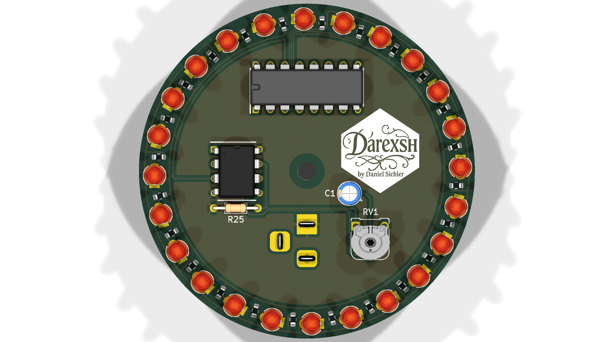
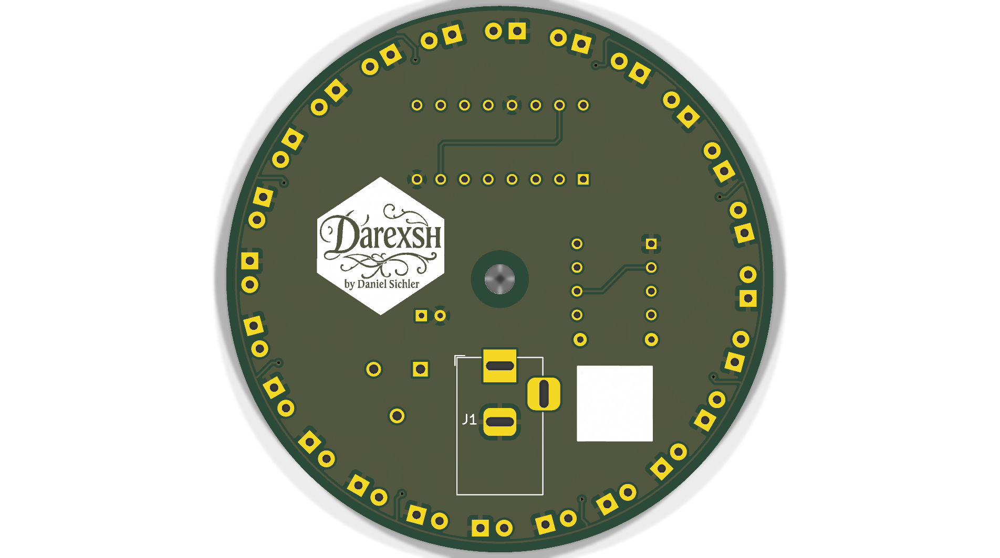

* * *

🌈 RGB Ringlight – LED Chaser
============================

**🟥🟩🟦 RGB LED Chaser using 3 mm LEDs**  

Powered by NE555, CD4017, and a speed control potentiometer

  

   
Check out my bot in Telegram for an easy project overview. If you want to support more projects, you can leave a small donation for a coffee.

* * *

✨ Authors
---------

| Name | GitHub | Role | Contact | Contributions |
| --- | --- | --- | --- | --- |
| **[Darexsh by Daniel Sichler](https://github.com/Darexsh)** | [Link](https://github.com/Darexsh?tab=repositories) | Hardware & Schematic 🖥️🛠️| 📧 [E-Mail](mailto:sichler.daniel@gmail.com) | Concept, Layout, Integration |

* * *

🚀 About the Project
--------------------

This project is an **RGB ring light with a chaser animation**, built entirely from discrete electronics.
The core consists of:
* **NE555:** Clock Generator
* **CD4017:** Decade Counter
* **24 LEDs:** Positioned in Circle shape with with alternatingly positioned red, green and blue LEDs
    
The **chase speed** can be adjusted using a **10 kΩ potentiometer**.
Power is supplied through a **9 V barrel jack (5.5 mm)**.
    

* * *

🛠️ How It Works
===========

🔁 **Main Function**
* The **NE555** operates in astable mode, generating a variable clock signal.
* The **CD4017** advances one output pin per clock pulse.
* Each LED lights up sequentially → creating the classic **LED chaser effect**.

💡 **LED Layout**

The ring contains **24 LEDs** total:
* 🔴 **D1–D8:** Red
* 🟢 **D9–D16:** Green
* 🔵 **D17–D24:** Blue

🎚️ **Speed Control**
* A **10 kΩ potentiometer (RV1)** adjusts the NE555 frequency.

🔌 **Power Supply**
* **9 V DC input**
* Supplied through a **5.5 mm barrel jack**

* * *

📋 Bill of Materials (BOM)
===========

| Part       | Value / Type                              |
| ---------- | ----------------------------------------- |
| **IC1**    | CD4017BE                                  |
| **IC2**    | NE555P                                    |
| **LEDs**   | 24× 3 mm LEDs (8× red, 8× green, 8× blue) |
| **R1–R24** | 680 Ω                                     |
| **R25**    | 10 kΩ                                     |
| **RV1**    | 10 kΩ potentiometer                       |
| **C1**     | 10 µF / 25 V                              |
| **J1**     | DC barrel jack 5.5 mm (with switch)       |
| **J2**     | Socket for CD4017                         |
| **J3**     | Socket for NE555                          |
| **H1**     | Mounting hole                             |

* * *

## 📜 License

This project is licensed under the **MIT License**.

This license applies to the updater application code in this repository. Upstream patch and app projects remain under their own licenses and notice terms.

**Copyright (c) 2026 Darexsh by Daniel Sichler**

You are free to use, copy, modify, merge, publish, distribute, sublicense, and sell this software under the terms of the MIT License.

When redistributing this project, you must include the original copyright notice and the MIT License permission notice.

**Developer:** Darexsh by Daniel Sichler.

The full license is available in the [LICENSE](LICENSE) file.

* * *

<!-- Keep this line! Rendered picture of PCB is going to be displayed after Production files are pushed to branch! -->

 Created with ❤️ by Daniel Sichler 

